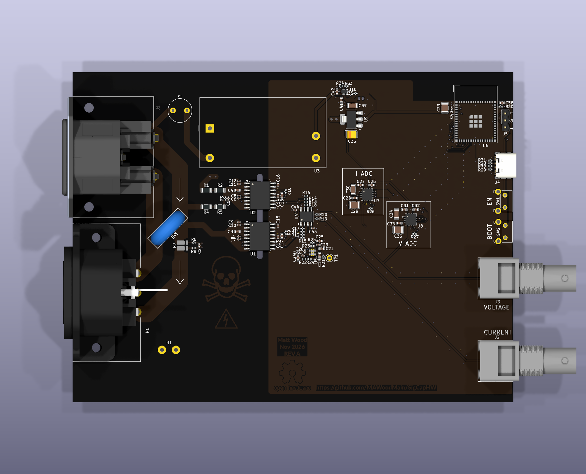

# SigCap — REV A

*KiCad top-view rendering with black solder mask. Some component bodies are omitted where 3D models are unavailable.*

SigCap measures AC line voltage and load current, with isolated analogue front ends, two oscilloscope outputs and an ESP32-S3 for digital capture. REV A hardware is on order; the figures below are nominal design values, pending bench validation.

For ESP32 settings, GPIO assignments and initial ADC configuration, see [ESP32 configuration and pin mappings](docs/ESP32.md).

## Capabilities

| Function | Hardware / nominal capability |
| --- | --- |
| Current sensing | 1 mΩ Kelvin shunt, AMC3302 isolated amplifier; approximately ±50 A measurement full scale |
| Voltage sensing | Resistive divider and AMC3330 isolated amplifier; approximately ±480 V peak measurement range |
| Analogue outputs | Two ground-referenced, bipolar BNC outputs, buffered by an OPA2320 |
| Digitisation | Two ADS8681W 16-bit ADCs, each rated up to 1 MSPS; internal references and programmable bipolar input ranges |
| Controller | ESP32-S3-MINI-1-N4R2: 4 MB flash, 2 MB PSRAM, Wi-Fi and Bluetooth LE |
| Host connection | USB-C for power, programming, console and firmware-defined data transfer; 3.3 V UART header |
| Power | Optional IRM-05-5 mains supply, or USB 5 V, selected by a TPS2116 power mux |

The 50 A figure provides measurement headroom for brief inrush events. It is **not a continuous load rating**: the mains connectors are rated 10 A, and the complete assembly still needs thermal and transient validation. Likewise, the voltage measurement range is not an installation/category safety rating.

The isolated amplifiers provide roughly 300 kHz bandwidth. Actual system response includes the input filters, output stages and ADCs. Sample rate, two-channel timing alignment and sustained capture/export rates have not yet been demonstrated.

## Connections

| Reference | Connection | Details |
| --- | --- | --- |
| J1 | AC input, Bulgin PF0030/PC | Pin 1 live, pin 2 neutral, pin 3 protective earth |
| P1 | Load output, Bulgin PX0675/PC | Pin 1 neutral, pin 2 live through the current shunt, pin 3 protective earth |
| H1 | Chassis earth spade | Connected to protective earth; bond to the conductive enclosure |
| J2 | Current BNC | Centre: current signal; shell: low-voltage GND |
| J3 | Voltage BNC | Centre: voltage signal; shell: low-voltage GND |
| J4 | USB-C | USB 2.0 data and 5 V input; no USB-PD negotiation |
| J5 | UART, 1×3 header | Pin 1 ESP TX / GPIO43; pin 2 GND; pin 3 ESP RX / GPIO44 |
| SW1 | RST | Pulls ESP enable low; resets the ESP, not the ADCs |
| SW2 | BOOT | Pulls GPIO0 low for ROM download mode during reset |
| TP1 | Analogue power-good | LM27762 PGOOD; low when both analogue rails are good; pulled up to 5 V otherwise |

Use PCB pad numbering and connector markings when wiring; the table is not a mating-face drawing. J5 requires a **3.3 V logic** USB-UART adapter with TX/RX crossed; it provides no power pin.

The BNC shells, USB ground and J5 ground are common. Protective earth is a separate net. Connecting an earthed scope or PC can earth the low-voltage domain. The live/neutral sensing circuitry remains on the hazardous side of the isolation barrier.

## Oscilloscope outputs

Use high-impedance inputs, normally 1 MΩ. **Do not enable 50 Ω termination.** R19/R20 provide 49.9 Ω series isolation; these outputs are not intended to drive a terminated 50 Ω load.

| Output | Nominal sensitivity | Example |
| --- | --- | --- |
| J2 current | 41 mV/A | 10 A → 0.410 V; 50 A → 2.05 V |
| J3 voltage | 4.158 mV/V | 230 V RMS sine → approximately 0.956 V RMS / 1.352 V peak |

The ADCs sample these same BNC signal nets after the series resistors. Calibrate offset, gain and polarity against known inputs; an external load on a BNC also affects its ADC reading.

## Initial power-up

1. With **mains disconnected**, inspect assembly and check for supply shorts. Finish the separately fitted J1, P1 and H1 connections as required before mains operation.
2. Power through USB using a current-limited source. Check +5 V, +3.3 V and the nominal analogue rails: about +2.46 V and −2.50 V relative to GND. Check for abnormal current or heating.
3. Confirm USB enumeration and follow the [ESP32 guide](docs/ESP32.md). Check ADC REFIO/REFCAP nodes near 4.096 V and verify idle readings near zero signal.
4. Validate each channel with known, isolated low-voltage/current test signals before live-mains testing. Use high-impedance probes on the low-voltage side only.

USB supplies the electronics; it does not isolate the mains terminals if mains is connected. F1 protects the IRM supply branch, not the through-load path. Live testing requires suitable upstream protection and an enclosed assembly.

## Design files and ordered substitutions

Open `SigCap.kicad_pro` in KiCad 10. `production/LATEST.txt` identifies the released manufacturing snapshot; `release/REV_A/` contains the release packs. The historical `AFE-design-notes.md`, `AFE_BOM.csv` and root `BOM.csv` describe earlier allocations and are not the bring-up reference.

The JLC order uses these compatible substitutions relative to the REV A schematic/BOM:

| Reference | Ordered part | JLC code | Change |
| --- | --- | --- | --- |
| U1 | AMC3302QDWERQ1 | C5214210 | Automotive-qualified version, same package/pinout and specified signal performance |
| U7, U8 | ADS8681WRUMR | C48913967 | Same ADC; larger reel packaging than WRUMT |

P1 is separately sourced as the original PX0675/PC. These substitutions require no PCB or firmware changes. The released design files have not been rewritten to reflect the order.
